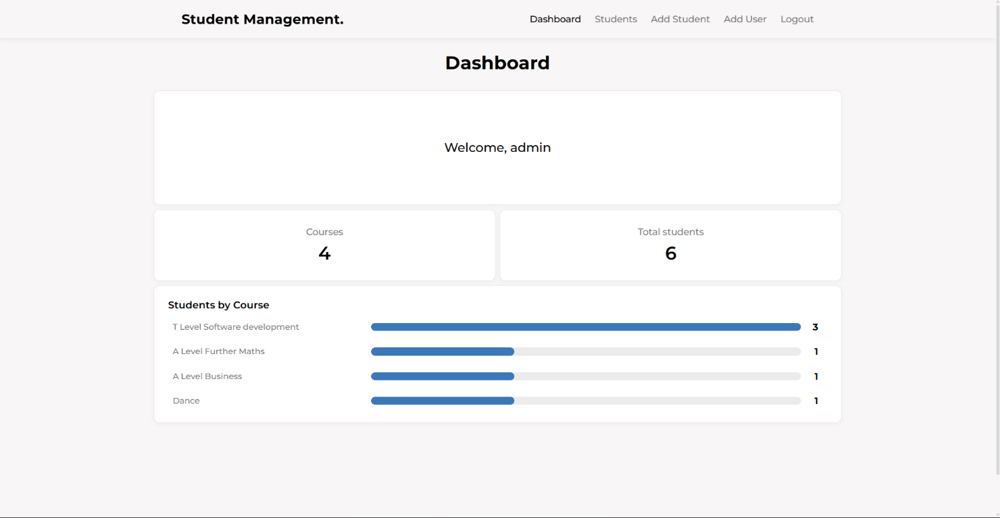
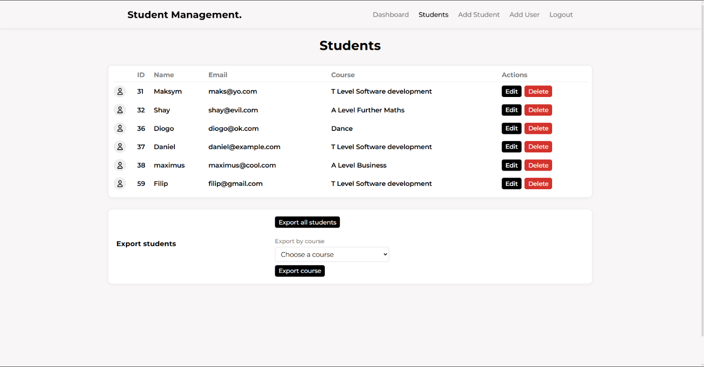
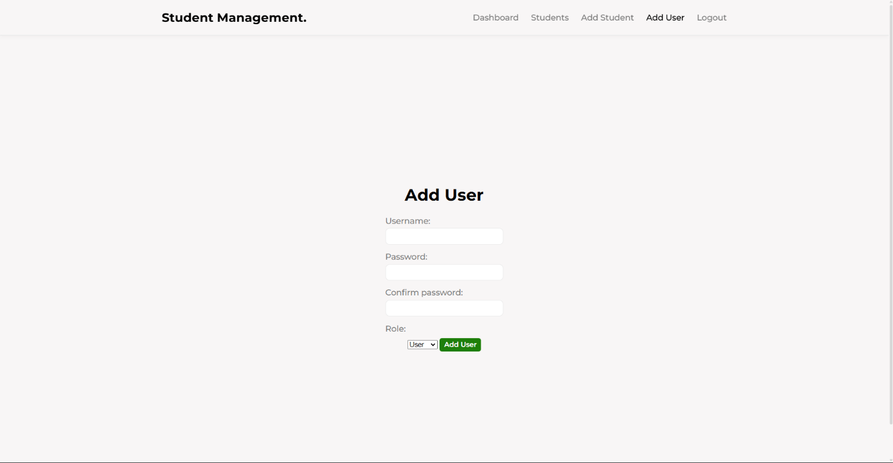

# Student Management System.

Used to manage students in a **SQL** database, and **display data** about courses onto a **dynamic** website.

This was built using **Python**, **Flask**, **Git**, AND **MySQL**, as a small solo project in class.

Includes a **login/logout system** using **sessions** and **accounts** - Features a **dashboard** page, **students list** page, **student editing**, and **student adding**.

This web application features **RBAC**: **admins** have elevated edit permissions, and **users** have view permissions.

User accounts are read from the MySQL `users` table with the columns `id`,
`username`, `password`, and `role`. New passwords are stored as Werkzeug
hashes, never as plain text. The existing admin account keeps its current
password and is upgraded to a hash the first time it logs in.

## Requirements
- [Python 3.14](https://www.python.org/downloads/release/python-3140/)
- A running MySQL server
- The required Database and tables
- Python packages in requirements.txt, installed with [pip](https://pip.pypa.io/en/stable/installation/)

## Setup
1. Clone the repository and open its folder.
2. Create and activate a Python virtual environment.
3. Install the dependencies with `pip install -r requirements.txt`.
4. Create the MySQL database and required tables referring to **MySQL configuration**.
5. Set the environment variables referring to **Powershell Commands**, then run the app with `python app.py`.

### MySQL configuration
Create the database and tables below in MySQL before starting the application.
The `users.id` and `students.id` columns increment automatically.

```sql
CREATE DATABASE college_db;
USE college_db;

CREATE TABLE users (
    id INT AUTO_INCREMENT PRIMARY KEY,
    username VARCHAR(100) NOT NULL UNIQUE,
    password VARCHAR(255) NOT NULL,
    role ENUM('user', 'admin') NOT NULL DEFAULT 'user'
);

CREATE TABLE students (
    id INT AUTO_INCREMENT PRIMARY KEY,
    name VARCHAR(100) NOT NULL,
    email VARCHAR(255) NOT NULL,
    course VARCHAR(255) NOT NULL
);
```

### Powershell Commands
Create a Python virtual environment:
```powershell
py -m venv .venv
```

Install the required packages:
```powershell
.\.venv\Scripts\python.exe -m pip install -r requirements.txt
```

Set the database connection details:
```powershell
$env:db_host = "localhost"
$env:DB_PORT = "3306"
$env:DB_NAME = "college_db"
$env:DB_USER = "root"
$env:DB_PASSWORD = ""
```

Generate and set the Flask secret key:
```powershell
$packagingKey = .\.venv\Scripts\python.exe -c "import secrets; print(secrets.token_hex(32))"
$env:FLASK_SECRET_KEY = $packagingKey
```

Start the Flask application:
```powershell
.\.venv\Scripts\python.exe -m flask --app app run
```

Set `DB_USER` and `DB_PASSWORD` to a MySQL account that can access
`college_db`. The application creates user password hashes when accounts are
added through **Add User**.

### Login
- Username: `admin`
- Password: `tlevel`

After logging in as an admin, use **Add User** in the navigation to create
additional accounts. The `id` column is generated automatically by MySQL.


### Important
- This project was created for practising Flask and front-end design skills; it is not production-ready and should not be considered secure.

## Screenshots

*These screenshots are from an Admin account on the web application hence the expanded permissions.*

### Dashboard


### Students table


### Add user

