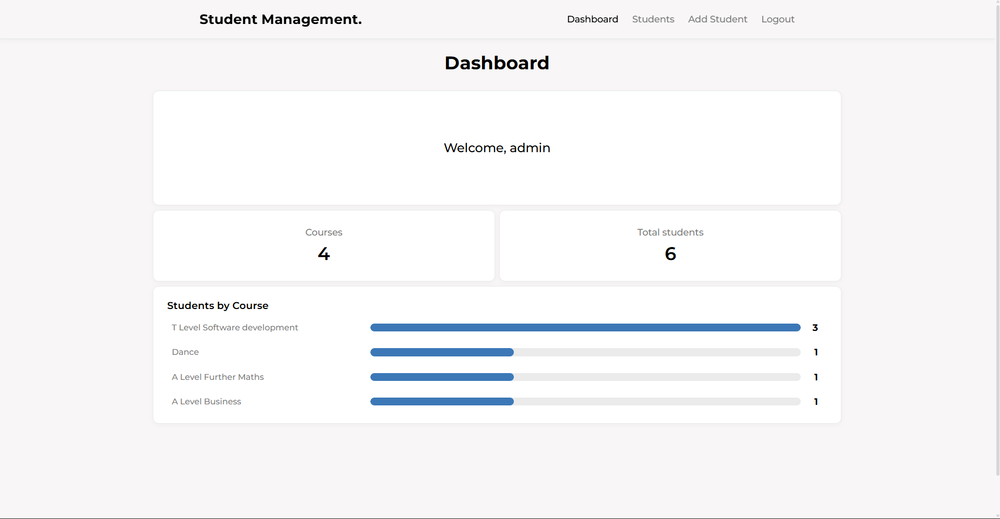
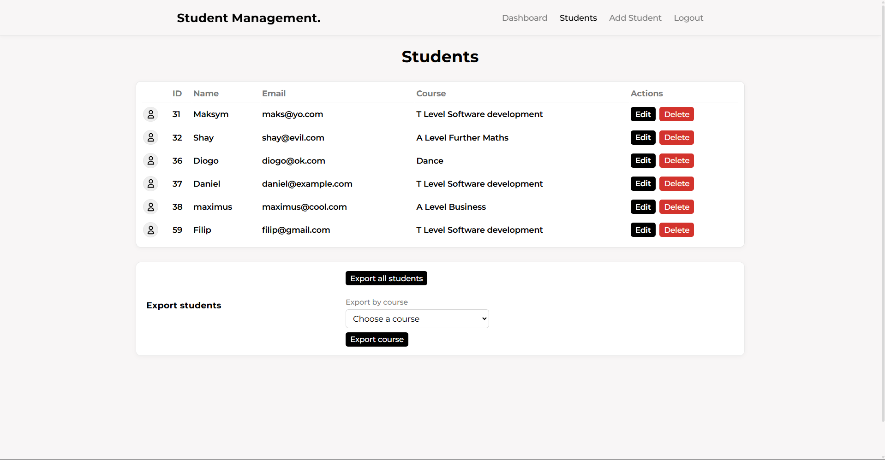

## Student Management System.

Used to manage students in a **SQL** database, and **display data** about courses onto a **dynamic** website.

This was built using **Python**, **Flask**, **Git**, AND **MySQL**, as a small solo project in class.

Includes a **login/logout system** using **sessions** and accounts - Features a **dashboard** page, **students list** page, **student editing**, and **student adding**.

## Requirements
- Python 3.14
- A running MySQL server
- The required Database and tables
- Python packages in requirements.txt

## Setup
1. Clone the repository and open its folder.
2. Create and activate a Python virtual environment.
3. Install the dependencies with `pip install -r requirements.txt`.
4. Create the MySQL database and required tables.
5. Set the environment variables, then run the app with `python app.py`.

## Important
- The MySQL database, tables, and local data are not included in this repository.
- This project was created for practising Flask and front-end design skills; it is not production-ready and should not be considered secure.

## Screenshots

### Dashboard

### Students
